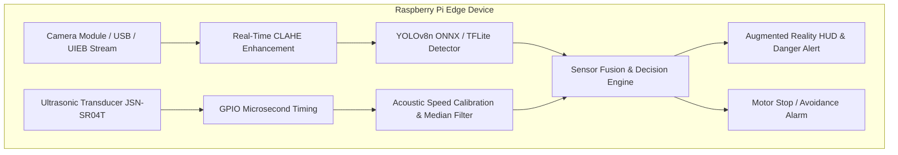

# Underwater Multi-Sensor Telemetry & Object Detection System
### Raspberry Pi 4 / 5 • Camera + Ultrasonic Sonar Fusion • UIEB Dataset • YOLOv8 / ONNX

---

## 1. System Overview & Dataset

This system implements an intelligent underwater navigation, telemetry, and obstacle avoidance pipeline for a **Raspberry Pi** equipped with a **Camera** and an **Ultrasonic Sonar Sensor**.

### Dataset Used: UIEB (Underwater Image Enhancement Benchmark)
- **Raw Photos (`dataset/uieb_raw/raw-890`)**: 890 real-world underwater photos downloaded from [larjeck/uieb-dataset-raw](https://www.kaggle.com/datasets/larjeck/uieb-dataset-raw) featuring varied turbidity, lighting, and marine features.
- **YOLO Training Split (`dataset/uieb_data`)**: Automatically labeled dataset split into `train` and `val` sets with YOLO bounding box annotations for marine life and obstacles.
- **Dataset Configuration (`dataset/uieb.yaml`)**: Ultralytics YOLO configuration for training and validation.

---

## 2. System Architecture



### Key Engineering Features
1. **Edge-Optimized YOLOv8n ONNX / TFLite Inference**:
   - Model is quantized to 320x320 resolution, delivering high FPS on quad-core ARM Cortex-A72 / A76 CPUs without discrete GPUs.
2. **Acoustic Medium Sound-Speed Calibration**:
   - Sound travels **~4.3x faster in water** than in air:
     - **Air**: $343\text{ m/s}$ ($34,300\text{ cm/s}$)
     - **Fresh water**: $1,482\text{ m/s}$ ($148,200\text{ cm/s}$)
     - **Seawater**: $1,530\text{ m/s}$ ($153,000\text{ cm/s}$)
   - The driver automatically calibrates based on the `UNDERWATER_MEDIUM` setting.
3. **Acoustic Median Filter**:
   - Rejects transient false reflections caused by bubbles, suspended silt, or acoustic multipath bounce.
4. **Lightweight Underwater CLAHE**:
   - Converts frames to CIELAB space and equalizes the L-channel, counteracting murky green/cyan turbidity in real time (<3 ms) without heavy GANs.
5. **Cross-Platform Simulation Layer**:
   - Automatically detects whether hardware GPIO and camera are available. Runs smoothly on Windows/Mac/Linux with simulated sensors or real UIEB image slideshow.

---

## 3. Hardware Wiring Diagram (Raspberry Pi)

### Ultrasonic Sensor (HC-SR04 or Waterproof JSN-SR04T)

> [!WARNING]
> Raspberry Pi GPIO pins are rated for **3.3V maximum**. The Echo pin of HC-SR04 / JSN-SR04T outputs **5V**. You **must** use a 2-resistor voltage divider (e.g., $1\,\text{k}\Omega$ and $2\,\text{k}\Omega$) on the Echo pin to step down 5V to ~3.3V.

```
Ultrasonic Sensor                    Raspberry Pi (40-Pin Header)
+-------------------+                +---------------------------+
| VCC   (5V)        | -------------> | Pin 2  (5V Power)         |
| GND   (0V)        | -------------> | Pin 6  (Ground)           |
| TRIG  (Trigger)   | -------------> | Pin 16 (GPIO 23)          |
| ECHO  (5V Out)    |                |                           |
+---------+---------+                +---------------------------+
          |
         [ 1k ohm ]
          |
          +------------------------> | Pin 18 (GPIO 24) [3.3V Safe]
          |
         [ 2k ohm ]
          |
         (GND)
```

### Camera Connection
- **Option A (CSI Ribbon Cable)**: Connect official Raspberry Pi Camera Module V2/V3 to the CSI port.
- **Option B (USB Waterproof Endoscope)**: Plug directly into any USB 2.0 / 3.0 port.

---

## 4. Repository Structure

```
d:\Underwater/
├── config.py                     # Pinouts, speeds of sound, thresholds, classes
├── requirements.txt              # Python dependencies
├── dataset/
│   ├── download_dataset.py       # Kagglehub UIEB raw dataset downloader
│   ├── prepare_uieb.py           # Auto-annotates UIEB images & creates YOLO splits
│   ├── uieb.yaml                 # YOLO dataset configuration
│   ├── uieb_raw/raw-890/         # 890 real-world underwater photos from Kaggle
│   └── uieb_data/                # YOLO structured dataset (images/train, labels/train, etc.)
├── hardware/
│   ├── ultrasonic_sensor.py      # Ultrasonic driver with median filter & simulation fallback
│   └── camera_stream.py          # Multi-threaded camera capture (supports UIEB image stream)
├── model/
│   ├── train_underwater_yolo.py  # Training pipeline for YOLOv8n on UIEB data
│   ├── export_for_pi.py          # Exporter to ONNX & TFLite
│   └── weights/
│       └── underwater_yolov8n.onnx # Edge-ready ONNX model weights
├── utils/
│   ├── hud_overlay.py            # Heads-Up Display with distance gauge & danger banners
│   └── image_enhancement.py      # Real-time underwater CLAHE in LAB space
└── deploy/
    ├── underwater_pi_fusion.py   # Multi-threaded edge sensor fusion runtime
    ├── run_uieb_stream.py        # Stream real UIEB raw photos through telemetry HUD
    └── run_simulation.py         # Visual PC simulation runner
```

---

## 5. Quickstart & Usage

### 1. Test Sensor Fusion on Real UIEB Photos
Stream the 890 downloaded real-world photos through the enhancement and sensor fusion pipeline:
```bash
python deploy/run_uieb_stream.py
```
*Outputs side-by-side comparison to `deploy/output/uieb_side_by_side_comparison.jpg`.*

### 2. Run the Full Real-Time Fusion on Raspberry Pi or PC
```bash
# Live Raspberry Pi Camera (CSI Camera Module or USB Webcam):
python deploy/underwater_pi_fusion.py

# Headless mode for remote Raspberry Pi via SSH / Terminal (live logging):
python deploy/underwater_pi_fusion.py --headless

# Run with test UIEB dataset photos instead of live camera:
python deploy/underwater_pi_fusion.py --source uieb --headless
```

### 3. Automatic Reference Image & Telemetry Logging
While running live on the Raspberry Pi:
- **Reference Images**: Saved automatically to `deploy/output/live_captures/` whenever:
  - An object/marine organism is detected (`capture_detect_<class>_<timestamp>.jpg`)
  - An obstacle is too close / collision danger `< 30 cm` (`capture_danger_<dist>cm_<timestamp>.jpg`)
  - You press `'s'` in the GUI window (`capture_manual_snap_<timestamp>.jpg`)
- **Telemetry CSV Log**: Automatically written to `deploy/output/telemetry_log.csv` recording:
  `[Timestamp, Filename, Distance_CM, Status, Detections, Trigger_Reason]`

### 4. Training & Exporting
```bash
# Train YOLO on the UIEB dataset
python model/train_underwater_yolo.py --epochs 30 --batch 16 --imgsz 320

# Export trained model to ONNX & TFLite for Raspberry Pi
python model/export_for_pi.py --weights model/weights/underwater_yolov8n_best.pt --imgsz 320
```

---

## 6. Telemetry & Safety Logic

| Condition | Status | Display | Action |
| :--- | :--- | :--- | :--- |
| **Distance > 60 cm** | `CLEAR` | Green HUD banner | Normal cruising |
| **30 cm ≤ Distance ≤ 60 cm** | `CAUTION` | Yellow HUD banner | Obstacle warning, slow speed |
| **Distance < 30 cm** | `DANGER` | Flashing red collision banner | Emergency stop / obstacle avoidance |
| **Camera Detections** | `OBJECT` | Box with class & % conf | Tag organisms (`fish`, `crab`, `diver`, `obstacle`) |
